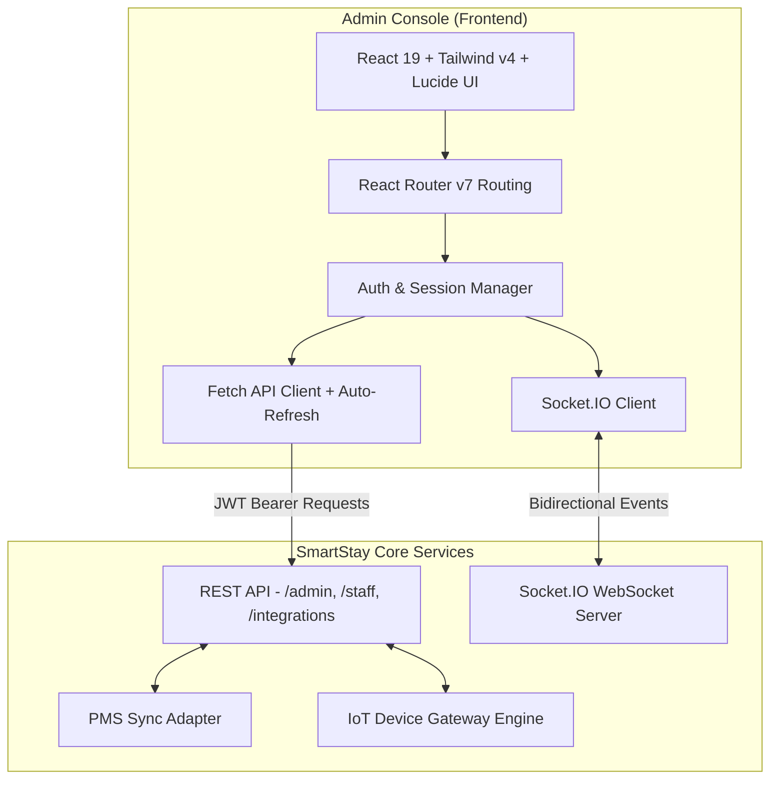

# Serene Hospitality (SmartStay) — Admin Console

[](https://react.dev/)
[](https://vitejs.dev/)
[](https://tailwindcss.com/)
[](https://socket.io/)
[](https://oxc.rs/)
[]()

> **Serene Hospitality / SmartStay Admin Console** is an enterprise-grade hospitality operations and room automation dashboard. It provides hoteliers, front desk agents, maintenance engineers, and general managers with real-time room telemetry, smart IoT device controls, guest manifest management, service request dispatching, PMS two-way sync, and energy optimization.

---

## Table of Contents

- [Key Features](#key-features)
- [System Architecture & Tech Stack](#system-architecture--tech-stack)
- [Module Overview](#module-overview)
- [Prerequisites](#prerequisites)
- [Installation & Quick Start](#installation--quick-start)
- [Environment Configuration](#environment-configuration)
- [Demo & Role Credentials](#demo--role-credentials)
- [Project Directory Structure](#project-directory-structure)
- [Real-Time WebSocket Events](#real-time-websocket-events)
- [Production Build & Deployment](#production-build--deployment)
- [Scripts Reference](#scripts-reference)

---

## Key Features

- **Interactive Room Matrix & Floor Board**: Real-time room status breakdown (Occupied, Vacant, Cleaning, Do Not Disturb, Maintenance, Make Up Room) grouped by floor with quick search, room type filters, and occupancy metrics.
- **Smart Room IoT Controls**: Bidirectional control and telemetry for in-room hardware, including smart lighting, HVAC / AC thermostats, mini-fridges, and smart TVs.
- **Front Desk & Daily Stays Manifest**: Comprehensive arrivals, departures, and active stays management with room assignment, check-in/out workflows, and automated digital key / QR generation.
- **Guest Relations CRM**: Detailed guest dossier with historical stays, VIP status tracking, preferences, and personal notes.
- **Guest Service Request Hub**: Live guest request dispatcher (amenities, housekeeping, room service, luggage, maintenance) with SLA counters, technician assignment, and status updates.
- **Two-Way PMS Synchronization**: Webhook and scheduled sync with hotel property management systems (Opera PMS, Mews, Cloudbeds) with conflict resolution and sync audit trails.
- **Energy Telemetry & Eco Schedules**: 24-hour and aggregate kilowatt-hour (kWh) tracking, automated eco-mode schedules, HVAC setpoint resets upon check-out, and off-peak load shedding.
- **Maintenance & Hardware Alerts**: Proactive equipment failure warnings, low-battery sensor notifications, device health diagnostics, and work order dispatching.
- **Device Topology**: Mesh network view covering hardware gateways, adapters (Zigbee, Z-Wave, Matter), RSSI signal strength, and offline status alerts.
- **Guest Sentiment & Feedback**: Direct review intake, Net Promoter Score (NPS) dashboards, and service recovery workflow.
- **Role-Based Access Control (RBAC)**: Fine-grained permissions for System Admins, Operations Managers, Guest Service Leads, Chief Technicians, and Front Desk Hosts.
- **Comprehensive Audit Trail**: Immutable logging of staff actions, device overrides, reservation changes, and security events.

---

## System Architecture & Tech Stack



### Core Technologies

| Layer | Technology | Details |
|---|---|---|
| **Framework** | [React 19](https://react.dev/) | Modern functional components with Hooks and Context API |
| **Bundler & Dev Server** | [Vite 8](https://vitejs.dev/) | Sub-second HMR and optimized asset bundling |
| **Styling** | [Tailwind CSS v4](https://tailwindcss.com/) | PostCSS-free compilation via `@tailwindcss/vite` |
| **Icons** | [Lucide React](https://lucide.dev/) | High-performance SVG icons |
| **Routing** | [React Router v7](https://reactrouter.com/) | Declarative browser routing and route protection |
| **Live Telemetry** | [Socket.IO Client](https://socket.io/) | WebSocket connection with fallback and automatic reconnection |
| **Linter** | [Oxlint](https://oxc.rs/) | High-speed JavaScript/JSX code quality verification |
| **QR Generation** | [qrcode.react](https://github.com/zpao/qrcode.react) | Client-side QR generation for digital keys and staff provisioning |

---

## Module Overview

| Route | View Component | Description |
|---|---|---|
| `/login` | `LoginScreen.jsx` | Secure staff authentication with quick demo credentials picker and OTP support |
| `/dashboard` | `DashboardContent.jsx` | High-level operations overview, occupancy KPIs, active alerts, and immediate actions |
| `/rooms` | `RoomsGridScreen.jsx` | Floor-by-floor room grid with quick device toggles and status indicators |
| `/rooms/:roomId` | `RoomDetailPage.jsx` | Deep-dive room inspection, device controls, temperature setpoint, stay history, and linked tickets |
| `/front-desk` | `FrontDeskView.jsx` | Daily manifest of arrivals, departures, room allocation, and instant check-in/out |
| `/guests` | `GuestsView.jsx` | Guest directory, VIP tiers, contact preferences, and stay profiles |
| `/requests` | `RequestsView.jsx` | Inbound guest service tickets with SLA tracking and staff assignments |
| `/alerts` | `MaintenanceAlertsView.jsx` | IoT hardware warnings, fault diagnostics, and work orders |
| `/energy` | `EnergyAnalyticsView.jsx` | Real-time and historical power consumption analytics by floor and room type |
| `/schedules` | `SchedulesView.jsx` | Automated energy-saving policies, quiet hours, and checkout resets |
| `/devices` | `DeviceTopologyView.jsx` | IoT infrastructure, hardware gateways, mesh topology, and RSSI metrics |
| `/feedback` | `FeedbackView.jsx` | Guest satisfaction ratings, sentiment analysis, and response tracking |
| `/pms` | `PmsSyncView.jsx` | PMS synchronization engine (Opera, Mews, Cloudbeds) and webhook logs |
| `/staff` | `StaffAccountsView.jsx` | Staff provisioning, roles, contact details, and account deactivation |
| `/settings` | `HotelSettingsView.jsx` | Operational rules (check-in times, currency, temperature units, quiet hours) |
| `/audit` | `AuditLogView.jsx` | Searchable historical audit logs for compliance and incident tracking |

---

## Prerequisites

- **Node.js**: `v18.0.0` or higher (Node.js 20+ LTS recommended)
- **Package Manager**: `npm` (v9+), `pnpm`, or `yarn`
- **Backend API**: SmartStay Backend or live API gateway (see [Environment Configuration](#environment-configuration))

---

## Installation & Quick Start

1. **Clone the repository and navigate to the admin directory:**
   ```bash
   git clone <repository-url>
   cd SmartStay/admin
   ```

2. **Install dependencies:**
   ```bash
   npm install
   ```

3. **Configure environment variables:**
   Create a `.env` file in the root of the `admin` folder (or copy `.env.example`):
   ```env
   VITE_API_URL=http://localhost:5000
   ```
   *(If omitted, the client defaults to `http://localhost:5000`, or routes requests via Vite proxy).*

4. **Start the local development server:**
   ```bash
   npm run dev
   ```
   The application will be accessible at:
   ```text
   http://localhost:5173
   ```

---

## Environment Configuration

| Variable | Type | Default | Description |
|---|---|---|---|
| `VITE_API_URL` | String | `http://localhost:5000` | Target URL for REST API endpoints and Socket.IO real-time server |

### Vite Proxy Configuration
For local development, `vite.config.js` is pre-configured with proxy rules targeting the development server (`https://dev.rekovryltd.com` or local backend):
- `/staff` ➡️ Staff authentication & session endpoints
- `/admin` ➡️ Rooms, stays, guests, telemetry, and operations APIs
- `/integrations` ➡️ PMS webhooks and external synchronization
- `/health` ➡️ System health checks
- `/socket.io` ➡️ WebSocket live telemetry stream

---

## Demo & Role Credentials

The console includes one-click role switching on the `/login` screen:

| Role | Email | Default Password | Permissions |
|---|---|---|---|
| **System Admin** | `admin@smartstay.local` | `ChangeMe123!` | Full unrestricted access to all modules, staff provisioning, and system settings |
| **Operations Manager** | `manager@smartstay.local` | `Password123!` | Operations, front desk, room matrix, analytics, schedules, and staff oversight |
| **Front Desk Host** | `frontdesk@smartstay.local` | `Password123!` | Check-in/out, room allocations, key generation, reservations, and guest requests |
| **Guest Service Lead** | `service@smartstay.local` | `Password123!` | Guest requests dispatch, feedback sentiment, housekeeping coordination |
| **Chief Technician** | `maintenance@smartstay.local` | `Password123!` | Hardware alerts, device topology, energy analytics, and room inspection modes |

---

## Project Directory Structure

```text
admin/
├── index.html                   # HTML entry point with Plus Jakarta Sans typography
├── package.json                 # Project dependencies and script declarations
├── vite.config.js               # Vite config with Tailwind v4 & backend proxy
├── .oxlintrc.json               # Oxlint configuration
├── public/                      # Static assets and favicons
└── src/
    ├── main.jsx                 # Application entry point with React Router DOM
    ├── App.jsx                  # Root router, shell layout, and live room state
    ├── index.css                # Tailwind CSS imports and design tokens
    ├── App.css                  # Custom styling overrides and animations
    ├── context/
    │   └── AuthContext.jsx      # JWT auth state, demo credentials, and socket binding
    ├── services/
    │   ├── apiClient.js         # HTTP client with bearer tokens & automatic refresh
    │   ├── socket.js            # Socket.IO connection manager & event dispatcher
    │   ├── authService.js       # Login, token rotation, and logout operations
    │   ├── roomsService.js      # Room board, room details, and CRUD operations
    │   ├── staysService.js      # Reservations, check-in/out, and guest allocation
    │   ├── frontDeskService.js  # Daily manifest and quick front desk stats
    │   ├── requestsService.js   # Guest service requests and assignment lifecycle
    │   ├── alertsService.js     # Maintenance alerts and fault resolution
    │   ├── energyService.js     # Real-time kWh consumption and floor telemetry
    │   ├── deviceService.js     # Hardware topology, battery levels, and mesh status
    │   ├── guestsService.js     # Guest CRM profiles and history
    │   ├── pmsService.js        # PMS synchronization and webhook replay
    │   ├── rulesService.js      # Automation rules and scheduled eco profiles
    │   ├── settingsService.js   # Hotel configuration and policy variables
    │   ├── staffService.js      # Staff user management and RBAC profiles
    │   ├── feedbackService.js   # Guest ratings and review analytics
    │   └── auditService.js      # Immutable system audit trail logs
    └── components/              # Operational views, modals, and interface components
        ├── Sidebar.jsx          # Collapsible responsive navigation bar
        ├── Header.jsx           # Global header with search, notifications, & quick action
        ├── ProtectedRoute.jsx   # Route guard enforcing active staff sessions
        ├── LoginScreen.jsx      # Staff authentication portal
        ├── DashboardContent.jsx # Operations KPI executive dashboard
        ├── RoomsGridScreen.jsx  # Multi-floor interactive room matrix
        ├── RoomDetailPage.jsx   # Detailed room view with IoT device controls
        ├── IoTRoomCard.jsx      # Room card with live switches (Lights, AC, Fridge, TV)
        ├── FrontDeskView.jsx    # Arrivals, departures, and active stays manifest
        ├── ReservationModal.jsx # Quick booking and room allocation modal
        ├── RequestsView.jsx     # Guest service request board
        ├── MaintenanceAlertsView.jsx # Hardware maintenance and fault management
        ├── EnergyAnalyticsView.jsx   # Telemetry graphs and consumption breakdowns
        ├── SchedulesView.jsx    # Eco-mode and automation schedules
        ├── DeviceTopologyView.jsx    # Hardware gateway and mesh adapter tree
        ├── GuestsView.jsx       # Guest CRM and profile dossiers
        ├── PmsSyncView.jsx      # PMS sync status and webhook logs
        ├── FeedbackView.jsx     # Guest reviews and NPS metrics
        ├── StaffAccountsView.jsx# Staff member management
        ├── HotelSettingsView.jsx# Property operational settings
        └── AuditLogView.jsx     # Activity and compliance audit logs
```

---

## Real-Time WebSocket Events

The application automatically connects to the WebSocket stream upon staff authentication using the active JWT bearer token:

| Event Name | Direction | Payload | Description |
|---|---|---|---|
| `board:room` | Server ➡️ Client | `RoomSummary` | Live update of an individual room state (occupancy, DND, device changes) |
| `board:refresh` | Server ➡️ Client | — | Triggers full refresh of all rooms on the current board |
| `request:new` | Server ➡️ Client | `ServiceRequest` | New incoming guest service request notification |
| `request:update` | Server ➡️ Client | `ServiceRequest` | Status transition or technician assignment change |
| `alert:new` | Server ➡️ Client | `MaintenanceAlert` | Triggered when a device detects a fault or low battery |
| `pms:sync` | Server ➡️ Client | `SyncStatus` | Live notification of incoming PMS sync batches |

---

## Production Build & Deployment

1. **Verify code quality:**
   ```bash
   npm run lint
   ```

2. **Generate optimized production bundle:**
   ```bash
   npm run build
   ```
   The compiled static assets will be output to the `dist/` directory.

3. **Preview production build locally:**
   ```bash
   npm run preview
   ```

4. **Deployment Options:**
   - **Static Web Host (Vercel, Netlify, Cloudflare Pages, S3/CloudFront)**: Deploy the `dist/` folder and ensure all single-page application routes redirect to `/index.html`.
   - **Nginx Reverse Proxy**: Configure `try_files $uri $uri/ /index.html;` and proxy `/staff`, `/admin`, and `/socket.io` to the backend cluster.

---

## Scripts Reference

| Command | Purpose |
|---|---|
| `npm run dev` | Runs the Vite local development server with Hot Module Replacement |
| `npm run build` | Builds the production bundle with tree-shaking and minification |
| `npm run preview` | Spins up a local web server to preview the built `dist/` output |
| `npm run lint` | Runs `oxlint` to quickly validate code standards and syntax |

---

## License

Copyright © 2026 Serene Hospitality Solutions & SmartStay. All rights reserved.
